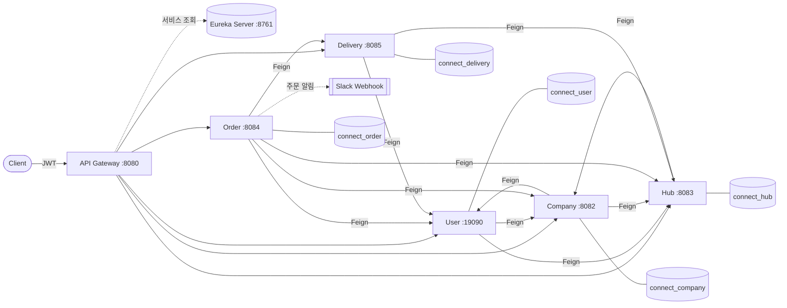
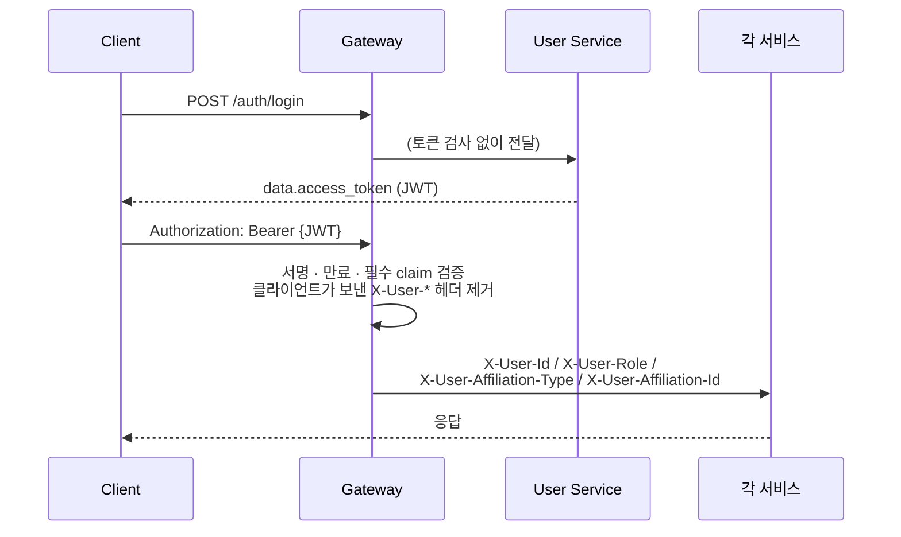
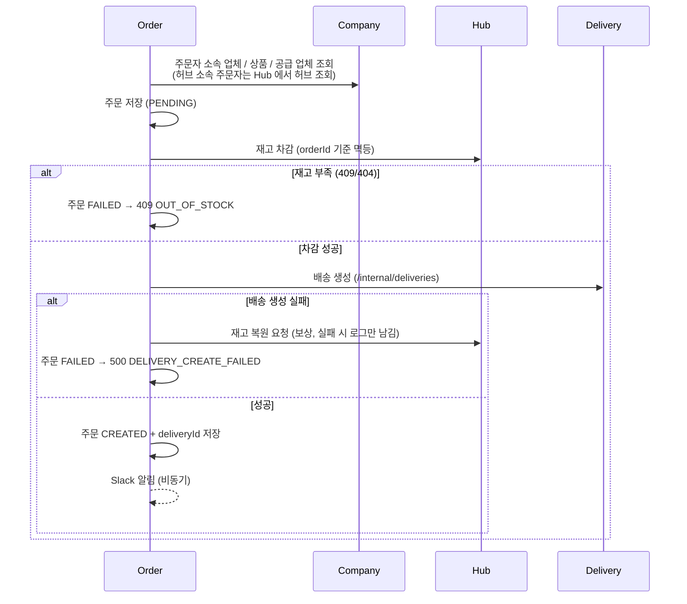

# Connect — MSA 기반 물류 관리 시스템

허브(물류 거점)·업체·상품·재고·주문·배송을 서비스별로 나누어 관리하는 **Spring Cloud 기반 마이크로서비스** 프로젝트입니다.
모든 외부 요청은 **API Gateway** 한 곳으로 들어와 JWT 인증을 거친 뒤, **Eureka** 에 등록된 각 서비스로 전달됩니다.

---

## 목차

1. [아키텍처](#아키텍처)
2. [기술 스택](#기술-스택)
3. [서비스 구성](#서비스-구성)
4. [인증 · 인가 흐름](#인증--인가-흐름)
5. [주요 비즈니스 흐름](#주요-비즈니스-흐름)
6. [API 목록](#api-목록)
7. [로컬 실행 방법](#로컬-실행-방법)
8. [API 문서 (Swagger)](#api-문서-swagger)
9. [테스트](#테스트)
10. [프로젝트 구조](#프로젝트-구조)
11. [협업 규칙](#협업-규칙)

---

## 아키텍처



- **Database per Service**: 서비스마다 별도의 PostgreSQL DB를 사용하고, 다른 서비스의 데이터는 Feign(HTTP) 으로만 조회합니다.
- **서비스 간 통신**: OpenFeign을 통한 서비스 간 HTTP 호출 및 Eureka 기반 서비스 탐색.
- **내부 호출용 API**: `/internal/**` 경로는 Gateway 라우트에 등록하지 않고 서비스 간 통신에 사용합니다. 서비스 포트에 직접 접근할 수 있는 환경에서는 별도의 네트워크 접근 제한이 필요합니다.

---

## 기술 스택

| 구분 | 사용 기술 |
|---|---|
| Language | Java 21 |
| Framework | Spring Boot 4.1.1, Spring Cloud 2025.1.3 |
| Gateway | Spring Cloud Gateway (WebFlux) |
| Service Discovery | Netflix Eureka |
| 서비스 간 통신 | Spring Cloud OpenFeign |
| 인증 | JWT (jjwt, HS512), Spring Security (user-service), BCrypt |
| Persistence | Spring Data JPA, PostgreSQL, QueryDSL 5.1 (delivery-service) |
| API 문서 | springdoc-openapi 3.1.1 (Gateway 통합 Swagger UI) |
| 모니터링 | Spring Boot Actuator, Micrometer Tracing + Zipkin |
| 알림 | Slack Incoming Webhook (주문 생성 알림, 비동기) |
| 테스트 | JUnit 5, Mockito, MockMvc, Testcontainers(PostgreSQL), H2 |
| Build | Gradle (모듈별 독립 빌드) |
| 실행 환경 | Docker, Docker Compose (전체 서비스 · PostgreSQL · Zipkin 일괄 실행) |

---

## 서비스 구성

| 모듈 | 서비스명 | 포트 | DB | 역할 |
|---|---|---|---|---|
| `connect.eureka-server` | eureka-server | 8761 | - | 서비스 등록 · 조회 |
| `connect.eureka-gateway` | eureka-gateway | 8080 | - | 단일 진입점, JWT 검증, 라우팅, 통합 Swagger |
| `connect.user-service` | user-service | 19090 | connect_user | 회원가입 · 로그인(JWT 발급), 회원 관리 |
| `connect.company-service` | company-service | 8082 | connect_company | 업체 · 상품 관리 |
| `connect.hub-service` | hub-service | 8083 | connect_hub | 허브 · 허브 간 경로 · 재고 관리 |
| `connect.order-service` | order-service | 8084 | connect_order | 주문 생성 · 수정 · 취소, Slack 알림 |
| `connect.delivery-service` | delivery-service | 8085 | connect_delivery | 배송 · 배송 경로 · 상태 관리 |

### 서비스별 핵심 기능

- **User**
  - 회원가입(항상 `USER` 권한으로 생성, BCrypt 암호화, 소속 업체·허브 존재 여부를 Company·Hub Service에 조회해 확인) / 로그인 시 JWT 발급
  - 회원 권한 관리: `MASTER`는 소속과 관계없이 전체 회원 조회·수정·삭제 가능, `USER`는 본인 정보만 조회 가능
  - 시스템의 **마지막 MASTER**는 삭제·강등 불가, 회원 삭제는 Soft Delete
  - 애플리케이션 시작 시 환경변수로 설정한 초기 MASTER 계정 생성 (`MasterAccountInitializer`)
- **Company**
  - 업체 CRUD (생성은 MASTER, 수정 · 삭제는 MASTER 또는 업체 관리자), 업체의 소속 허브 존재 여부 검증(Hub 호출)
  - 업체 관리자 지정 (MASTER 만, 대상이 그 업체 소속 사용자인지 User 에 조회해 확인)
  - 상품 CRUD (등록 · 수정 · 삭제는 업체 관리자 또는 MASTER)
  - 업체 · 상품 삭제 시 Hub 의 관련 재고 삭제 요청
- **Hub**
  - 허브 · 허브 간 경로(거리, 소요 시간) 조회, 기동 시 초기 데이터 적재(`HUB_SEED_ENABLED`)
  - 재고 등록 · 입고 (MASTER 또는 해당 업체 관리자)
  - 주문용 재고 차감 · 복원 · 조정 (orderId / adjustmentId 기준 **멱등 처리**), 재고 변경 이력(StockHistory)
- **Order**
  - 주문 생성: 상품 검증 → 재고 차감 → 배송 생성, 배송 생성 실패 시 재고 복원을 요청하고 주문을 `FAILED` 로 기록 (복원 요청이 실패하면 로그만 남김)
  - 주문 수정(수량 차이만큼 재고 조정 · 수령인 변경), 주문 취소(배송 취소 → 재고 복원 요청 → Soft Delete, 재고 복원이 실패해도 주문은 취소되고 로그만 남김)
  - 내가 한 주문 / 내 업체가 받은 주문 조회, 주문 생성 시 Slack 알림(비동기)
- **Delivery**
  - 배송 및 배송 경로 생성(Hub 경로 조회로 예상 거리·시간 저장), 같은 주문은 한 번만 생성
  - 생성 시 출발 허브 소속 사용자 중 진행 중인 배송이 가장 적은 사람을 담당자로 자동 배정 (User 조회 실패 · 대상 없음이면 미배정)
  - 상태 전이: `HUB_WAITING → HUB_MOVING → DEST_HUB_ARRIVED → OUT_FOR_DELIVERY → DELIVERED` (대기 중에만 `CANCELED`), 배송 담당자 또는 MASTER 가 처리
  - 허브 도착 시 실제 이동거리를 입력받고, 실제 소요시간은 허브 출발 ~ 도착 시각으로 자동 계산
  - 미배정 배송 목록 조회 후 출발 허브 소속 사용자가 본인을 담당자로 배정 / MASTER 의 담당자 변경, 수령인 변경, 조건 검색(QueryDSL), Soft Delete

---

## 인증 · 인가 흐름



- JWT claim: `username`, `userId`, `role`(`MASTER`/`USER`), `affiliationType`(`COMPANY`/`HUB`), `affiliationId`
- 토큰 없이 통과하는 경로: `/auth/login`, `/auth/signup`, 통합 Swagger 문서 경로(`/docs/{서비스}/v3/api-docs`)
- 인증 실패 시 Gateway 응답: `401 {"code":"UNAUTHORIZED" | "INVALID_TOKEN", "message": "..."}`
- Company · Hub · Order · Delivery 는 JWT 를 다시 파싱하지 않고 Gateway 가 넣어 준 `X-User-*` 헤더로 권한을 판단합니다.
  (클라이언트가 직접 `X-User-*` 헤더를 보내도 Gateway 가 제거하므로 위조할 수 없습니다.)
- User Service 는 Gateway 가 그대로 전달한 `Authorization` 헤더를 자체 Spring Security 필터(`JwtAuthorizationFilter`)로 다시 검증하고, DB 에서 회원을 조회해 권한을 판단합니다. (`/auth/login`, `/auth/signup`, `/internal/**` 는 인증 없이 허용)
- MASTER 는 소속과 관계없는 시스템 전체 관리자로 처리됩니다.
- **Gateway 와 user-service 는 같은 `JWT_SECRET_KEY` 를 사용해야 합니다.**

---

## 주요 비즈니스 흐름

### 주문 생성 (보상 처리 포함)



- 분산 트랜잭션(Saga 프레임워크, 메시지 브로커)은 사용하지 않고, **동기 호출 + 실패 시 보상 호출** 방식입니다.
  보상 호출(재고 복원 · 재조정)이 실패해도 재시도하지 않고 로그만 남기므로, 이 경우 재고는 수동으로 확인해야 합니다.
- 주문 수정 · 취소는 배송이 `HUB_WAITING` 상태일 때만 가능합니다.

---

## API 목록

> 외부 호출은 모두 Gateway(`http://localhost:8080`)를 통해야 하며, 로그인 · 회원가입 외에는 `Authorization: Bearer {JWT}` 가 필요합니다.
> 상세 요청/응답 스펙은 [Swagger](#api-문서-swagger) 를 참고하세요.

### User

| Method | Path | 설명 |
|---|---|---|
| POST | `/auth/signup` | 회원가입 (USER 권한) |
| POST | `/auth/login` | 로그인, JWT 발급 |
| GET | `/users/{userId}` | 회원 단건 조회 (USER는 본인, MASTER는 전체 회원) |
| GET | `/users` | 회원 목록 조회 (MASTER, 전체 회원) |
| PUT | `/users/{userId}` | 회원 수정 (MASTER) |
| DELETE | `/users/{userId}` | 회원 삭제 (MASTER, Soft Delete) |
| GET | `/users/user-info` | 로그인한 회원 정보 |

### Company · Product

| Method | Path | 설명 |
|---|---|---|
| POST | `/companies` | 업체 생성 |
| GET | `/companies/{companyId}` | 업체 단건 조회 |
| GET | `/companies` | 업체 목록 조회 |
| PUT | `/companies/{companyId}` | 업체 수정 |
| DELETE | `/companies/{companyId}` | 업체 삭제 (상품 · 재고 함께 정리) |
| PATCH | `/companies/{companyId}/manager` | 업체 관리자 지정 · 변경 (MASTER) |
| POST | `/companies/{companyId}/products` | 상품 등록 |
| GET | `/companies/{companyId}/products/{productId}` | 상품 단건 조회 |
| GET | `/companies/{companyId}/products` | 상품 목록 조회 |
| PUT | `/companies/{companyId}/products/{productId}` | 상품 수정 |
| DELETE | `/companies/{companyId}/products/{productId}` | 상품 삭제 |

### Hub · Stock

| Method | Path | 설명 |
|---|---|---|
| GET | `/hubs` | 허브 목록 |
| GET | `/hubs/{hubId}` | 허브 단건 조회 |
| GET | `/hubs/routes` | 허브 간 경로 목록 |
| GET | `/hubs/routes/{departureHubId}/{arrivalHubId}` | 두 허브 간 경로 조회 |
| POST | `/hubs/stocks` | 재고 등록 |
| POST | `/hubs/stocks/inbound` | 재고 입고 (수량 추가) |
| GET | `/hubs/stocks` | 재고 목록 |
| GET | `/hubs/stocks/{stockId}` | 재고 단건 조회 |

### Order

| Method | Path | 설명 |
|---|---|---|
| POST | `/orders` | 주문 생성 |
| GET | `/orders/{orderId}` | 내 주문 단건 조회 (MASTER 는 전체) |
| GET | `/orders` | 내 주문 목록 (`page`, `size` ≤ 100) |
| GET | `/orders/received/{orderId}` | 받은 주문 단건 조회 (공급 업체 담당자) |
| GET | `/orders/received` | 받은 주문 목록 (MASTER는 전체, 업체 관리자는 실패 주문 제외) |
| PUT | `/orders/{orderId}` | 주문 수정 (수량 · 요청사항 · 수령인) |
| DELETE | `/orders/{orderId}` | 주문 취소 |

### Delivery

| Method | Path | 설명 |
|---|---|---|
| GET | `/deliveries/{deliveryId}` | 배송 단건 조회 |
| GET | `/deliveries` | 배송 검색 (상태 · 담당자 · 허브 · 수령인, `size` 10/30/50) |
| GET | `/deliveries/unassigned` | 내 소속 허브에서 출발하는 담당자 미배정 배송 목록 (HUB 소속) |
| POST | `/deliveries/{deliveryId}/hub-departure` | 허브 출발 |
| POST | `/deliveries/{deliveryId}/hub-arrival` | 목적지 허브 도착 (본문 `actualDistance` 필수) |
| POST | `/deliveries/{deliveryId}/delivery-start` | 업체 배송 출발 |
| POST | `/deliveries/{deliveryId}/complete` | 배송 완료 |
| POST | `/deliveries/{deliveryId}/delivery-user` | 배송 담당자 배정 (출발 허브 소속 본인) |
| PATCH | `/deliveries/{deliveryId}/delivery-user` | 배송 담당자 변경 (MASTER) |
| PATCH | `/deliveries/{deliveryId}/receiver` | 수령인 변경 |
| DELETE | `/deliveries/{deliveryId}` | 배송 삭제 (완료 · 취소된 배송만) |
| GET | `/deliveries/routes/{deliveryId}` | 배송 경로 기록 조회 |

### 내부 API (`/internal/**`, Gateway 미노출)

| 제공 서비스 | Method | Path | 호출하는 서비스 |
|---|---|---|---|
| User | GET | `/internal/users/{userId}` | Order (Slack 알림), Company (업체 관리자 지정 시 소속 확인) |
| User | GET | `/internal/users/hub/{departureHubId}/delivery-users` | Delivery (배송 생성 시 담당자 자동 배정) |
| Company | POST | `/internal/companies` | 없음 (가입 시 업체 생성용으로 구현되어 있으나 User Service 에서 아직 호출하지 않음) |
| Hub | POST | `/internal/hubs/stocks/decrease` · `/restore` · `/adjust` | Order |
| Hub | POST | `/internal/hubs/stocks/delete` | Company (업체 · 상품 삭제) |
| Hub | GET | `/internal/hubs/stocks/histories` | 없음 (재고 변경 이력 조회용, 현재 호출하는 서비스 없음) |
| Delivery | POST | `/internal/deliveries` · `/internal/deliveries/cancel` | Order |

### 공통 응답 형식

성공 (예: `POST /orders`)

```json
{
  "success": true,
  "message": "주문이 생성되었습니다.",
  "data": {
    "id": "6f1c2a3b-1d2e-4f50-8a9b-0c1d2e3f4a5b",
    "requesterCompanyId": "1a2b3c4d-5e6f-4a7b-8c9d-0e1f2a3b4c5d",
    "supplierCompanyId": "2b3c4d5e-6f7a-4b8c-9d0e-1f2a3b4c5d6e",
    "productId": "3c4d5e6f-7a8b-4c9d-0e1f-2a3b4c5d6e7f",
    "deliveryId": "4d5e6f7a-8b9c-4d0e-1f2a-3b4c5d6e7f8a",
    "quantity": 2,
    "requestMessage": "문 앞에 놓아주세요",
    "receiver": "홍길동",
    "orderStatus": "CREATED",
    "createdAt": "2026-10-20T12:00:00",
    "updatedAt": "2026-10-20T12:00:00"
  },
  "timestamp": "2026-10-20T12:00:00"
}
```

실패 (예: Delivery Service `DELIVERY_NOT_FOUND`)

```json
{
  "code": "DELIVERY_NOT_FOUND",
  "message": "배송을 찾을 수 없습니다."
}
```
---

## 로컬 실행 방법

### Docker Compose 로 한 번에 실행

PostgreSQL, Zipkin, Eureka, Gateway 와 5개 도메인 서비스를 컨테이너로 함께 실행합니다. (Docker 필요)

1. 루트의 `.env.example` 을 `.env` 로 복사하고 값을 채웁니다.
   - `POSTGRES_USER`, `POSTGRES_PASSWORD`, `JWT_SECRET_KEY`
   - 초기 MASTER 계정: `MASTER_USERNAME`, `MASTER_PASSWORD`, `MASTER_EMAIL`, `MASTER_AFFILIATION_TYPE`(기본 `HUB`), `MASTER_AFFILIATION_ID`, `MASTER_SLACK_ID`
   - (선택) `SLACK_WEBHOOK_URL`
2. 실행

```bash
docker compose up -d --build
```

- Gateway `http://localhost:8080`, Eureka `http://localhost:8761`, Zipkin `http://localhost:9411`
- 서비스별 DB 는 Postgres 컨테이너를 처음 만들 때 `docker/postgres/init.sql` 이 생성합니다. 호스트에서 접속할 때 포트는 `HOST_PG_PORT`(기본 `15432`)입니다.
- 이미지 빌드 시 테스트는 실행하지 않습니다 (`docker/Dockerfile`, `bootJar -x test`).

아래는 Docker Compose 없이 모듈별로 직접 실행하는 방법입니다.

### 1. 사전 준비

- JDK 21
- PostgreSQL (Docker 권장)
- (선택) Zipkin `localhost:9411`, Slack Incoming Webhook URL

### 2. 데이터베이스 생성

각 서비스가 사용하는 DB를 만들어 둡니다. (테이블은 `ddl-auto: update` 로 자동 생성)

```sql
CREATE DATABASE connect_user;
CREATE DATABASE connect_company;
CREATE DATABASE connect_hub;
CREATE DATABASE connect_order;
CREATE DATABASE connect_delivery;  -- 기본 설정은 localhost:5433
```

### 3. 환경변수 설정

민감한 값은 git 에 올리지 않고 환경변수 또는 모듈 폴더의 `.env` 로 주입합니다. `.env.example` 을 `.env` 로 복사해 값을 채워 주세요.
(`.env` 를 자동으로 읽는 모듈은 user-service, eureka-gateway 이며, **실행 위치(working directory)가 해당 모듈 폴더**여야 합니다.)

| 서비스 | 환경변수 | 설명 |
|---|---|---|
| eureka-gateway | `JWT_SECRET_KEY` | JWT 서명 키 (user-service 와 동일, Base64URL 64바이트 이상) |
| user-service | `DB_URL`, `DB_USERNAME`, `DB_PASSWORD` | DB 접속 정보 (기본 `localhost:5432/connect_user`) |
|  | `JWT_SECRET_KEY` | Gateway 와 동일한 키 |
|  | `admin.masters[n].*` | (선택) 초기 MASTER 계정 — `user-service/.env.example` 참고 |
| company-service | `COMPANY_DB_URL`, `POSTGRES_USER`, `POSTGRES_PASSWORD` | DB 접속 정보 (기본 `localhost:5432/connect_company`) |
| hub-service | `HUB_DB_URL`, `POSTGRES_USER`, `POSTGRES_PASSWORD` | DB 접속 정보 (기본 `localhost:5432/connect_hub`) |
|  | `HUB_SEED_ENABLED` | 허브 · 경로 초기 데이터 적재 여부 (기본 `true`) |
| order-service | `ORDER_DB_URL`, `POSTGRES_USER`, `POSTGRES_PASSWORD` | DB 접속 정보 (기본 `localhost:5432/connect_order`) |
|  | `EUREKA_URL` | **필수** 예: `http://localhost:8761/eureka/` |
|  | `SLACK_WEBHOOK_URL` | (선택) 비우면 알림을 보내지 않음 |
| delivery-service | `DELIVERY_DB_URL`, `POSTGRES_USER`, `POSTGRES_PASSWORD` | DB 접속 정보 (기본 `localhost:5433/connect_delivery`) |
|  | `JWT_SECRET` | 설정 값 바인딩용 |

### 4. 실행 순서

**Eureka Server → 각 도메인 서비스 → Gateway** 순서로 실행합니다. 각 모듈은 독립 Gradle 프로젝트입니다.

```bash
cd connect.eureka-server && ./gradlew bootRun
```

```bash
cd connect.user-service && ./gradlew bootRun
```

```bash
cd connect.company-service && ./gradlew bootRun
```

```bash
cd connect.hub-service && ./gradlew bootRun
```

```bash
cd connect.order-service && ./gradlew bootRun
```

```bash
cd connect.delivery-service && ./gradlew bootRun
```

```bash
cd connect.eureka-gateway && ./gradlew bootRun
```

- Eureka 대시보드 `http://localhost:8761` 에서 모든 서비스가 `UP` 인지 확인합니다.

### 5. 빠른 동작 확인

```bash
curl -X POST http://localhost:8080/auth/login -H "Content-Type: application/json" -d "{\"username\":\"{아이디}\",\"password\":\"{비밀번호}\"}"
```

응답의 `data.access_token` 을 이후 요청의 `Authorization: Bearer {토큰}` 헤더로 사용합니다.
(초기 MASTER 계정은 user-service 의 `admin.masters[n]` 설정으로 생성됩니다.)

---

## API 문서 (Swagger)

Gateway 에서 서비스별 OpenAPI 문서를 모아 하나의 Swagger UI 로 제공합니다.

- 통합 Swagger UI: `http://localhost:8080/swagger-ui/index.html` (상단 드롭다운에서 서비스 선택)
- 현재 제공: **company-service**, **delivery-service**

새 서비스 문서를 추가하려면

1. 해당 서비스에 `springdoc-openapi-starter-webmvc-ui` 의존성 추가 (`/v3/api-docs` 제공)
2. Gateway `application.yml` 에 `/docs/{서비스}/v3/api-docs` 라우트(`StripPrefix=2`)와 `springdoc.swagger-ui.urls` 항목 추가

> 개발 환경용입니다. 운영에서는 `springdoc.swagger-ui.enabled=false` 등으로 문서를 비공개로 두는 것을 권장합니다.

---

## 테스트

모듈별로 실행합니다.

```bash
cd connect.order-service && ./gradlew test
```

| 서비스 | 테스트 DB | 비고 |
|---|---|---|
| user-service | H2 (`application-test.yml`) | 로컬 DB 불필요 |
| company-service | Testcontainers PostgreSQL | Docker 필요 |
| hub-service | PostgreSQL (별도 테스트 설정 없이 `application.yml` 의 DB 사용) | 테스트 전용 DB 를 지정해서 실행 권장 |
| order-service, delivery-service | Service · Entity 단위 테스트(Mockito) + 컨텍스트 로딩 테스트 | 컨텍스트 로딩에 DB 접속 필요 |
| eureka-gateway | JWT 필터 단위 테스트, Swagger 라우트 통합 테스트 | - |

- 다른 서비스 호출(Feign)은 테스트에서 Mock 으로 대체합니다. 즉, 서비스 내부 동작만 검증하며 **여러 서비스를 실제로 연결한 E2E 검증은 별도로(Postman 등) 수행**해야 합니다.
- 테스트는 반드시 개발 · 운영 DB 와 분리된 DB 에서 실행하세요.

---

## 프로젝트 구조

```
connect
├── .github/ISSUE_TEMPLATE
├── docker-compose.yml         # 전체 서비스 일괄 실행
├── docker                     # 공통 Dockerfile, Postgres 초기화 SQL(init.sql)
├── connect.eureka-server      # Service Discovery
├── connect.eureka-gateway     # API Gateway + JWT 필터 + 통합 Swagger
├── connect.user-service       # 회원 · 인증
├── connect.company-service    # 업체 · 상품
├── connect.hub-service        # 허브 · 경로 · 재고
├── connect.order-service      # 주문
└── connect.delivery-service   # 배송
```

각 도메인 서비스는 대체로 다음 구조를 따릅니다.

```
src/main/java/connect/{service}
├── domain (또는 기능별 패키지)
│   ├── controller   # 외부 API, Internal*Controller(내부 API)
│   ├── service
│   ├── repository
│   ├── entity
│   └── dto
├── client           # 다른 서비스 호출용 Feign Client
└── global           # 공통 응답(ApiResponse), 예외(ErrorCode, GlobalExceptionHandler), 설정
```

---

## 협업 규칙

### 브랜치 전략

| 브랜치 | 용도 |
|---|---|
| `master` | 배포 기준 브랜치 |
| `develop` | 통합 개발 브랜치 (기능 브랜치의 PR 대상) |
| `feature/{도메인 또는 기능}` | 기능 개발 (예: `feature/order`, `feature/hub`) |
| `fix/{내용}` | 버그 · 설정 수정 |

### 커밋 메시지

`type: 내용` 형식을 사용합니다.

| type | 의미 |
|---|---|
| `feat` | 기능 추가 |
| `fix` | 버그 · 설정 수정 |
| `docs` | 문서 |
| `refactor` | 리팩터링 |
| `test` | 테스트 |

### 공통 규칙

- `.env` 등 민감한 값은 커밋하지 않고 `.env.example` 만 관리합니다.
- 삭제는 `deletedAt` / `deletedBy` 를 기록하는 **Soft Delete** 를 사용합니다.
- 서비스끼리만 쓰는 API 는 `/internal/**` 경로에 두고 Gateway 에 라우트를 추가하지 않습니다.
